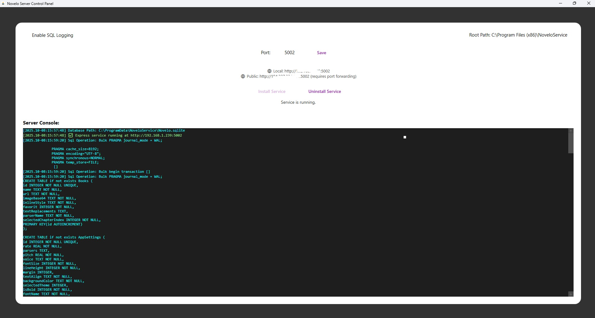

# Novelo Database Service
If you want to be able to access your [Novels](https://github.com/1-AlenToma/Novelo) from differend system then you could use this softwere.

# How to
[Download NoveloServiceInstaller.exe](https://github.com/1-AlenToma/Novelo.Service/raw/refs/heads/main/NoveloServiceInstaller.exe) and install it.

* Open `Novelo Service` that will exist on desktop.

* Configure which `port` to use default could be `5002`

* On the app you will see something like this

```
Server running(local) on http://192.168.1.256:5002
Server running(public) on http://194.237.234.174:5002 port forwarding required to use
```

For public use you will have to open the require port both on router and windows firewall.

For Info on how to port forwarding [read here ](https://www.google.com/search?q=windows+port+forward&oq=windows+port+fowr&gs_lcrp=EgZjaHJvbWUqCQgBEAAYDRiABDIGCAAQRRg5MgkIARAAGA0YgAQyCQgCEAAYDRiABDIICAMQABgNGB4yCAgEEAAYDRgeMggIBRAAGA0YHjIICAYQABgNGB4yCAgHEAAYDRgeMgoICBAAGAoYDRgeMggICRAAGA0YHtIBCDc3MjhqMGo3qAIAsAIA&sourceid=chrome&ie=UTF-8)

Open `Novelo App` go to `Settings/App Server` and add the `Server running(local)` or `Server running(public)` info.

Click save and restart the app.

Now all your data will be saved on your PC and Novelo app will be using the data on your PC insetad


